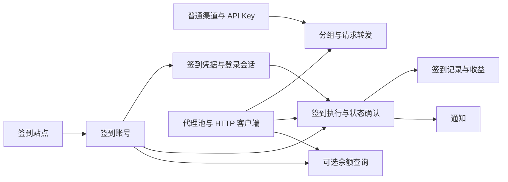

# v2 开发路线：普通渠道与独立签到

开发分支：`v2`。起点：`2158e12`（`feat(proxy): add SOCKS5H support`）。

本文件记录设计约定、实施依赖、验收标准和实际进度。完成项必须附实现位置或验证结果；部分完成不能勾选整个阶段。迁移预检通过只表示已完成报告覆盖的检查，不代表可以跳过备份、实际迁移及迁移后验收。

## 进度

| 阶段 | 状态 | 完成条件 |
| --- | --- | --- |
| P0 分支与路线 | 已完成 | 创建 v2，保存设计、阶段和验收标准 |
| P1 行为基线与迁移预检 | 已完成 | 已实现离线 JSON/ZIP 配置预检、转换清单、异常分类和样本回归 |
| P2 新签到数据与会话 | 已完成 | 独立 CRUD、凭据与代理保护、会话登录/刷新编排完成；MySQL/PostgreSQL 实际并发验证通过 |
| P3 独立签到执行 | 已完成 | HTTP/内置平台、会话、调度/批次、余额收益、持久化通知及三种数据库服务验收通过 |
| P4 新 API 与前端 | 已完成 | 独立 API、签到页面与全局 v2 界面完成；默认/v2 前端回归及构建通过，生产切换待 P5 |
| P5 数据迁移与备份 | 未开始 | 渠道转换、新旧备份、重入及三种数据库迁移验证 |
| P6 删除旧模块与发布验收 | 未开始 | 移除订阅/投影运行时、更新文档、完成完整回归 |

开发按阶段推进。正式切换前必须同时完成迁移、接口和运行时适配，不在新旧服务之间双写。P1 的离线工具不执行数据库迁移。

## 目标与业务边界

保留普通渠道、分组、请求转发、模型同步、日志和渠道统计。现有投影渠道原位转换为普通渠道，不重新创建渠道或 Key。

签到站点、账号、凭据、会话、调度、状态确认、余额查询、收益和通知归签到模块管理。渠道与签到之间不建立业务绑定，共用代理池、HTTP 客户端、数据库和通知基础设施。



最终除旧数据转换代码外，业务不再引用订阅账号关联、`SiteChannelBinding`、`SiteToken`、`SiteUserGroup`、`SiteModel`。新建数据库不创建订阅业务表。

## 新数据模型

| 模型 | 主要职责与数据 |
| --- | --- |
| CheckinSite | 名称、平台、签到地址、启用/归档、代理默认值、公共 Header、时区/时间窗口、内置或 HTTP 执行方式、状态规则、奖励提取规则 |
| CheckinAccount | site_id、名称、credential_id、代理覆盖、自动签到/随机时间、下一次执行、最近结果、余额配置、待确认工作流 |
| CheckinCredential | 凭据类型、认证平台/地址、用户名/密码、Access Token、Refresh Token、Cookie、用户 ID、有效期、版本和刷新租约 |
| CheckinLog | 执行 ID、站点/账号 ID、名称快照、状态/原因、奖励、批次和时间 |
| CheckinBatchJob | 选中范围、进度、成功/失败/待确认数量及执行时间 |

新增 `checkin_sites`、`checkin_accounts`、`checkin_credentials`。现有签到日志和批次表可通过新模型的 TableName 映射复用，减少历史数据搬迁。有效签到站点/账号尽量保留原 ID；新记录自增序列必须与保留 ID 对齐。

新签到模型移除 `SiteKind`、`LinkedSiteID`、`LinkedAccountID`、`CheckinUseSubscriptionToken` 及订阅同步字段、模型/Key/分组/渠道关联。`CheckinSourceAccountID` 的来源追踪由迁移映射记录承担。

账号与凭据分离：通常一账号一凭据；共享同一登录会话时显式引用同一凭据。共享凭据没有渠道引用，不按用户名或 Token 内容自动去重。删除凭据前检查主签到和余额引用；删除账号不删除其他账号仍在使用的凭据。历史日志通过快照保留可读性，不级联删除。

归档只修改站点归档状态并清空待重算的调度时间，保留站点/账号启用设置、凭据和待确认任务；恢复不会重新启用原本停用的站点。归档站点拒绝新增账号。有账号的站点不能直接删除，账号存在未完成的已提交任务时也不能删除，应先归档/停用并完成状态确认。账号与站点删除不级联处理凭据、渠道或日志。

## 凭据版本与会话

`credential_version` 用于所有人工编辑和自动刷新写入的乐观锁；`identity_revision` 用于人工更换身份、类型或认证配置后的工作流失效判断。自动刷新不递增身份修订号，不中断正常待确认任务。

更新凭据必须携带预期版本，冲突返回 409。列表返回类型、配置状态、有效期、版本和引用数量；秘密字段只在修改时提交，省略表示保留。账号与新建内嵌凭据在同一事务中保存。

编辑补丁在事务锁内与当前记录合并。`false`、`0`、空字符串均是明确赋值；`proxy_config_id`、外部签到地址、状态规则、平台用户 ID 可用 `null` 清空，数组可用 `[]` 或 `null` 清空。`balance_config` 整体替换，`null` 表示禁用并解除自定义余额引用。凭据的 `expected_version` 必填；秘密字符串不能传 `null`，清除可选秘密需显式提交空字符串，必需秘密仍受模型校验约束。补丁拒绝归档状态、执行结果、提交标记、刷新租约等服务器字段。

站点执行配置变更会清除旧能力验证并重算调度，账号执行/调度配置变更也清除原调度时间。两者均不改写原工作流指纹或已提交标记；恢复与是否允许再次提交由 P3 执行层判断。站点锁串行化账号配置变更；共享凭据和代理按 ID 排序加锁，内嵌凭据创建失败完整回滚。

迁移现有 Sub2API 并发合并、数据库刷新租约、Token 成对保存、取消后限时完成保存及保存失败恢复逻辑。不能在多份记录上轮转同一个 Refresh Token。人工编辑与刷新冲突时，保留现有判断会话是否已更换的语义，设置编辑不能丢弃已签发的新令牌。

会话管理器 `internal/checkin.Sessions` 每个服务实例长期复用，按 `credential_id` 合并请求；数据库租约协调不同实例。`Ensure` 获取当前会话，`RecoverRead` 接受被拒绝的会话快照，为一次状态/余额重查获取新会话，不负责重发业务请求。密码凭据的用户名/密码变更会清除旧登录产生的 Token、Cookie 和用户 ID；自动登录与刷新只增加写入版本，不增加身份修订号。

在发送登录/刷新请求前持久化 `token_refresh_started`，不把租约过期当作可以重用 Refresh Token 的证据。请求超时、响应损坏、HTTP 5xx 等结果不明确时，保留标记并要求恢复已收到的结果或更换凭据；明确未消费的失败（发送前代理失败、HTTP 429）写入跨实例退避时间。认证交换单次上限 30 秒，保存总上限 5 秒、最多 3 次并指数退避；调用方取消不撤销共享交换或已签发凭据的保存。保存失败时在当前进程保留新 Token 对，后续仅重试保存；进程退出后没有新 Token 对可恢复，数据库标记阻止重复兑换，需人工获取新的登录凭据。

凭据摘要返回 `session_state: idle | exchanging | cooldown | needs_credentials`，不返回刷新所有者和秘密。会话备份以 `session_needs_repair` 保留结果不明确状态，不导出或恢复租约、锁及退避时间，避免导入后重用可能已消费的 Refresh Token。

AgentRouter 登录本身触发签到，不能在普通凭据测试或余额查询中自动登录。各平台的能力差异由适配器约束，不能把 API Key 一概作为平台签到凭据。

已实现 NewAPI/OneAPI/OneHub/DoneHub 的用户名密码登录、AnyRouter 的 Token/Cookie 登录、Sub2API 的 Access/Refresh Token 轮转，以及已有 Cookie/API Key 的读取。认证使用凭据自己的地址、代理和 Header。AgentRouter 的显式登录经过签到提交预占，通用会话服务只读取已有 AgentRouter 会话。AnyRouter 使用个人资料接口核对用户 ID，登录和后续请求收到的 Cookie 按来源、路径、Secure、失效时间和删除状态保存在凭据内。备份 DTO 携带这些属性，普通凭据响应仅返回配置摘要。

## 地址、代理与认证

| 用途 | 地址 | 代理与 Header |
| --- | --- | --- |
| 签到提交和状态查询 | CheckinSite | 账号覆盖站点默认配置 |
| 登录和 Token 刷新 | CheckinCredential 认证地址 | 明确的认证代理、User-Agent、认证 Header |
| 余额查询 | 账号余额配置 | 独立配置或主凭据模式的继承值 |

普通平台默认认证地址为签到地址；外部 HTTP 签到可独立配置。HTTP 身份模式明确为 Cookie 或 Bearer，身份 Header 由凭据管理器注入，自动刷新由平台能力决定。保留原有重定向限制。

原 Sub2API 订阅令牌模式的签到/状态查询实际使用源账号代理及源站 User-Agent，迁移时将生效值写入新配置。同一旧登录会话存在不兼容认证网络配置时报告冲突，不悄悄复制或统一令牌。

代理池删除和引用计数要覆盖新签到站点、账号、认证及余额配置；禁用或缺失的池节点不能静默回退直连。

引用按配置用途计数：站点默认代理、账号覆盖、凭据认证、账号自定义余额各计一次；账号继承站点或余额继承凭据不重复计数。归档/停用不会解除引用。过渡期共享代理服务在新表存在时合并这些引用，新表尚未创建时可继续使用；元数据查询失败会返回错误，不能当作无引用处理。正式切换在 P6 移除旧实体查询。

## 余额与收益

账号可选 `BalanceConfig`，初期作为结构化配置字段保存，包含 `mode`、`platform`、`base_url`、`credential_id`、代理和 Header。

| mode | 行为 |
| --- | --- |
| disabled | 仅从签到/状态响应提取奖励 |
| primary | 使用主凭据及其平台服务地址查询余额 |
| custom | 独立配置余额地址、平台、凭据和网络 |

外部 Cookie 签到和到账平台凭据均由签到模块管理，不需要订阅站。奖励优先级：自定义提取结果、默认响应奖励、本次签到前后余额差。保留有效 0；失败/重复签到不重复记收益；余额失败不改变成功结果；恢复确认不使用过期余额快照补算。保持现有单位和收益统计语义。

`internal/checkin.Balances.Query` 实现三种模式，单次网络查询限时 10 秒，保存另有 5 秒预算。`primary` 使用主凭据的认证平台、地址、代理和 Header；`custom` 使用独立配置。支持 NewAPI、OneAPI、OneHub、DoneHub、AnyRouter、AgentRouter 和 Sub2API。管理平台支持密码、Access Token 和 Cookie，Sub2API 支持 Access Token/API Key。401 最多恢复一次读取会话，AgentRouter 始终禁止隐式登录。Cookie 绑定认证源，读取失败返回的撤销标记也按版本保存。

额度默认按 500000 换算为 USD；OneAPI/OneHub 用总额度减已用额度，其余管理平台按剩余额度解释；AgentRouter 优先读取 `quota_per_unit`，Sub2API 直接读取货币余额。缺失或非法字段不覆盖旧值，成功查询记录 `balance_updated_at`。账号查询版本和余额配置版本、凭据身份修订共同阻止迟到响应和配置改回原值后的旧响应写入。纯数值解析及奖励算法在 `internal/checkin/finance`，旧业务通过该包复用。

同次执行取得有效前后快照、配置/身份一致且期间无其他余额观察时，才为缺失奖励补算余额差，并加上非递减累计消费差。凭据被多个账号引用时不推断到账归属；仍保存响应明确给出的奖励。AgentRouter 不用余额差推断奖励。奖励只回填对应成功日志的空字段，不重写既有奖励或重复记账；恢复确认无旧基线可用。余额服务的失败和超时不改变已提交结果，额外查询预算与签到请求预算分开。

`TodayIncome` 继续表示上游今日入账，与本地签到奖励独立。上游未返回该字段时，NewAPI/OneAPI/AnyRouter/AgentRouter 按服务器本地日历查询 type=1/4 入账日志，每类最多 6 页；分页不完整则保留原值。`CheckinStore.ListHistory` 和 `RewardStats` 复用分页及统计规则，站点名称从 `checkin_sites` 解析，已删除站点保留历史快照；支持来源、批次、账号、状态、时间及游标筛选，不读取订阅业务表。

## 持久化通知

签到最终结果与 `checkin_completions` 在同一事务写入，以日志 ID + 最终状态去重。失败后显式确认成功可以生成独立成功事件；重放、重复确认和待确认状态不重复入队。成功后刷新余额及补齐奖励再放行通知；进程中断后，事件最迟在 30 秒后具备扫描资格，扫描会读取对应状态日志中的已保存奖励，不重新补算余额差。

`NewNotifications(store, config)` 显式注入配置，`engine.WithNotifications(service)` 接入结果通知，`Jobs.RunDue` 唤醒恢复扫描，也可直接调用 `Notifications.RunDue`。复用 `internal/notify` 的五种渠道和模板，保留失败、低余额、可选成功的事件优先级、手动开关、冷却时间及旧 webhook 配置解析。手动批次归类为手动触发，确认沿用工作流最初来源。服务每次最多读取 128 个事件/投递任务，四个发送 worker，网络调用位于事务外。

`checkin_notification_deliveries` 以事件和目标指纹唯一约束去重；`checkin_notification_cooldowns` 保存账号、事件、原因、目标维度的冷却时间。`checkin_notification_gates` 的协调行串行化短事务，多实例同时扫描也只授予一个发送者。目标只保存指纹，不保存 URL、Token 或 SMTP 密码；发送前重读配置，已关闭的通知或已移除的目标标记 `canceled`。发送成功才开始冷却，冷却期间的新任务标记 `suppressed`。

投递状态包括 `queued`、`sending`、`delivered`、`suppressed`、`canceled`、`uncertain`。传输错误或发送中断后无法证明是否送达，因此不会自动重发已标记发送的任务；超时任务恢复为 `uncertain`。`CheckinStore.ListNotifications` 可查询状态，`RetryNotification` 可显式重试结果未知的投递（至少等待原发送预算结束），重试可能产生重复消息。尚未发送的持久化任务可以在重启后继续。P4.1 已提供状态查询与显式重试 API，P4.2 已补齐界面入口与重复送达确认提示，不能宣称第三方通知端到端恰好一次。

## 执行与工作流约束

1. 加载最新站点、账号和凭据，检查启用、归档和配置完整性。
2. 优先恢复已有工作流，已提交任务只查询状态。
3. 获取会话，按平台规则提前刷新或恢复鉴权。
4. 执行配置要求的前置状态查询和可选余额快照。
5. 所有签到提交均先持久化提交标记，收到数据库提交确认后才发送一次签到。
6. 保存结果、调度时间，成功后刷新余额、补齐奖励并通知。

查询可按原规则恢复鉴权并重查；提交不能因超时或 401 自动重发。账号互斥和数据库工作流 CAS 分别保留。同一次工作流复用日志 ID；已提交标记在重启、迁移及恢复后均保留。手动/批量/定时入口重新检查停用和归档状态。

指纹使用执行配置、时区、credential_id、identity_revision 及实际请求网络配置，不包含自动轮转的 Access Token。迁移前先检查旧指纹有效性，再验证转换前后语义一致并重算新指纹；旧无效任务不能自动重新变成有效任务。

P3 当前实现 `internal/checkin.Engine` 的自定义 HTTP 工作流：`Execute` 创建或恢复执行，`Confirm` 只查询已有的已提交任务。账号的 `checkin_workflow_version` 与工作流日志 ID 共同控制状态转换；提交预占成功前不会发送 HTTP，数据库提交确认丢失时保留预占并禁止发送。提交请求关闭重定向、请求体重放和连接复用；401 只允许在后续状态查询中恢复会话一次，不重发签到。

前置状态为已签到时直接记录成功且不记奖励；未知状态不提交。已提交任务在取消、重启、日志缺失后仍只确认状态，缺失日志按原 ID 重建。确认失败或过期后仍可显式 `Confirm`；同日已经结束的提交由 `Execute` 返回原结果。只有未提交且未成功的失败、过期或配置失效任务允许手动重新开始。提交前再次检查日期、期限、配置指纹、停用/归档和定时时间窗口，自动入口还要求账号开启自动签到。

跨日确认要求日期字段或显式 JavaScript 判定；仅返回“今日状态”的接口在请求前后都检查日期，避免午夜响应确认错误日期。状态和奖励脚本共用 `internal/checkin/rules` 的受限运行时，旧路径通过薄封装复用。响应奖励与日志、账号最近结果在同一事务保存，竞争确认只允许一次写入，保留有效 0；恢复确认仅使用明确选择的状态响应奖励，不补算丢失的提交响应或旧余额差。余额奖励另以成功日志空字段 CAS 回填，通知使用完成后的持久化结果。

内置平台沿用同一账号工作流和日志。NewAPI、OneAPI、OneHub 和 DoneHub 使用管理签到接口。DoneHub 在自动模式下默认关闭，手动签到成功后按站点配置指纹保存可用性。AnyRouter 可使用独立 Cookie、Access Token 或密码凭据，按实际会话选择一次提交的接口。个人资料读取遇到 401 时，密码凭据可以恢复一次会话。服务端要求人机验证时返回 `verification_required`，由用户在站点完成验证。结果记录保留 `submitted`，供用户判断是否已有签到请求发出。

AgentRouter 的登录本身就是签到。数据库确认提交预占后才发送登录，成功证据为当天登录响应的 `data.checked_in == true`，或原工作流日期内的签到成功日志。恢复时按站点时区查询原日期，已经发生的签到归为“已签到”，奖励留空。并发确认期间，其他实例可以读到待确认记录，原执行仍可保存登录结果。

调度和批次通过 `internal/checkin.Jobs` 复用同一个长期存活的 Engine。共享时间计算位于 `internal/checkin/schedule`，按站点日历、时间窗口和随机延迟计算下一次执行。随机时间持久化后跨扫描和重启复用。保存工作流结果时，账号状态、日志和下一次执行时间在同一事务提交。跨日确认成功时按原工作流日期安排下一次签到。

`RunDue` 扫描到期账号，在事务内重读启用状态和工作流版本。未提交的前置检查在有效窗口内继续，已提交且支持查证的任务按原日期确认。默认每 10 分钟再次确认，并受确认期限约束。期限或配置失效后，原日志记为失败并保留提交标记。发送前的请求构造失败按 15 分钟起、最高 2 小时退避，凭据获取失败退避 6 小时，均对齐签到窗口。明确需要人工验证的结果安排到后续签到日，用户可完成验证后手动处理。

批次显式选择 `all` 或非空 `selected`。同范围活动批次由数据库事务复用，范围冲突返回服务错误 `ErrCheckinBatchActive`，P4.1 已将其映射为 HTTP 409。批次沿用开启自动签到的账号筛选，按站点和账号顺序执行，请求之间间隔 500 毫秒。数据库中的单行租约协调多个实例，期限为 1 分钟，每 20 秒续期，失效后由扫描、查询或新建批次标记中断。每次发送前检查活动批次与账号的提交预占。

批次提供创建、执行、查询和分页列表入口，记录成功、失败、跳过、待确认和取消状态。统计保留批次结束时的快照，后续状态确认更新签到日志。工作流保存首次执行的来源和批次 ID，缺失日志恢复时沿用这些字段。用户发起批次后的 HTTP 请求结束不影响批次执行，执行器取消会保留已提交账号的待确认记录。同一轮遇到人工验证时，跳过该站点的剩余账号。

## 后端边界

| 位置 | 职责 |
| --- | --- |
| internal/model/checkin_*.go | 数据结构、纯校验、DTO |
| internal/op/checkin_*.go | CRUD、版本/租约、工作流提交、日志和统计 |
| internal/checkin | 执行、批次、调度、状态、收益、通知和平台适配 |
| internal/server/handlers/checkin_*.go | 管理员 API、参数和响应 |
| internal/task/checkin.go | 调度入口 |
| internal/migration/v2 | 旧数据预检、映射和转换；允许访问旧 DTO |

业务服务可以依赖新数据访问函数和基础设施，数据层不能反向依赖签到编排。保留使用到的登录、Cookie 会话、验证码、余额等能力，从 `internal/sitesync` 提取后再删除订阅专属代码。`projected_channel_auto_group.go` 中的普通渠道通用函数先移动，再删除投影分支。

## API 与界面

接口前缀为 `/api/v1/checkin`：

| 路径 | 操作 |
| --- | --- |
| /sites，/sites/:id | GET/POST、GET/PATCH/DELETE |
| /sites/:id/archive，/restore | POST |
| /accounts，/accounts/:id | GET/POST、GET/PATCH/DELETE |
| /credentials，/credentials/:id | 摘要 GET/POST、GET/PATCH/DELETE |
| /accounts/:id/execute，/confirm | POST；后者只确认已提交任务 |
| /accounts/:id/balance | POST，独立刷新余额 |
| /batches，/batches/:id | POST/GET、GET |
| /logs，/stats，/capabilities | GET |
| /reward/test，/status/test | POST，仅本地样例测试 |
| /notifications | GET，投递状态游标分页 |
| /notifications/:id/retry | POST，显式重试符合条件的未知投递 |

P4.1 接口契约与请求示例见 [docs/checkin-api-v2.md](docs/checkin-api-v2.md)。全部接口使用管理员 JWT；普通凭据响应只返回摘要。站点/账号默认启用，账号自动签到默认关闭。PATCH 保留省略字段，接受显式 false/0，标量 null 无效；内嵌配置与查询参数严格校验。普通 JSON 请求限 1 MiB，本地规则样例限 2 MiB。日志、批次、通知和待确认任务的长 ID 及分页游标均以十进制字符串返回；分页默认 50、最大 100。业务错误映射到稳定 `checkin.*` 代码，原始存储/传输错误不进入响应或访问日志。

创建账号的 `credential` 与 `credential_id` 二选一。批次显式使用 `scope: all | selected`；selected 必须是非空有效范围，不得回退到全量。重复同范围活动批次复用，冲突范围返回 409。

前端移除订阅站导航和投影页签。签到页面管理全部站点、凭据、余额配置、记录和收益。渠道统一编辑；分组按渠道/协议展示；日志移除订阅模型禁用操作；代理引用更新到新实体。移除订阅同步和投影全局设置，保留普通模型同步和签到调度。

P4.2 已实现独立签到页面，专用类型/hooks 位于 `web/src/api/endpoints/checkin*.ts`，页面位于 `web/src/components/modules/checkin/`。P4.3 将临时构建开关扩展为 `NEXT_PUBLIC_V2_UI=1`，同时切换导航、渠道、分组、日志、代理引用和设置；原 `NEXT_PUBLIC_CHECKIN_V2` 已移除。默认入口仍沿用旧页面，生产路由/任务切换和开关移除与 P5/P6 协调。新签到页面业务请求仅使用独立 API，不依赖旧订阅 DTO，也不在失败时回退旧接口。该前端开关不创建新表或迁移数据，联调后端仍需显式装配 P4.1 服务。开发命令与验收边界见接口文档的「前端开发入口」。

P4.3 对浏览器保存的旧订阅导航和投影页签进行归一化。普通渠道保留编辑能力与原 ID；未迁移的托管渠道统一显示并提示迁移，仍禁止启停、编辑和删除，也不再提供旧来源跳转。有未迁移渠道时，自动分组禁止保存，避免修改仍受投影全局模式覆盖的配置。实际解除托管标记、展开全局覆盖和保留渠道/Key/分组关联属于 P5。

v2 分组按渠道/协议展示，日志保留错误、请求内容和重试诊断，不查询旧站点模型操作目标。代理引用支持签到站点、账号执行、凭据认证及余额查询四种用途，引用键和跳转严格区分新旧实体 ID；保留旧引用计数和删除保护，失效引用只提示刷新。设置页使用独立批次接口执行全量签到并轮询字符串 ID，调度入口指向签到站点配置；不挂载旧订阅同步及签到任务组件。此阶段只验收前端请求路径独立，共享后端旧依赖待 P5/P6 切换清理。

正式切换删除订阅和 `/api/v1/site-channel` 接口。旧数据兼容集中在转换代码，不增加永久旧接口转发或旧表回读。

## 投影渠道转换

保留渠道/Key ID、地址、协议、模型、Key、Header、参数覆盖、代理及当前启用状态，保留 GroupItem、权重、优先级和普通渠道统计。清除托管标记和绑定。

将投影全局自动分组覆盖值写入各原投影渠道的 AutoGroup；解除投影不会自动开启模型同步。已经按协议拆分的渠道分别保留，不重新合并。不从旧订阅缓存生成不存在的渠道。

旧 StatsSiteModelHourly 按账号/分组/模型统计，不合并进普通渠道累计值，避免重复计算；作为迁移归档保留。移除转发中的站点模型路由学习和后台重新投影。

现有删除/归档站点服务会删除投影渠道，迁移不能调用这些业务删除接口。

## 数据库升级

顺序：预检、备份、停止旧写入、建新表与迁移记录、签到/凭据迁移、余额迁移、渠道转换、工作流校验、运行时切换。

迁移版本和阶段状态必须持久化；记录来源 ID 映射。重复执行不重复创建凭据或覆盖已完成数据。MySQL DDL 与 DML 分阶段处理，不假设建表可以随数据事务一起回滚。覆盖 SQLite、MySQL 和 PostgreSQL。

缺失关联凭据时保留账号和历史并暂停自动执行，提示补充配置；不使用残留旧秘密作为自动回退。已提交任务缺少凭据时保留提交标记。余额失效不阻断独立 Cookie 签到。异常渠道引用进入报告，不自动删改。

首次切换可暂存旧表归档，后续独立清理。新运行时不再读写旧表。回退使用迁移前备份；不能将保留旧表误认为支持旧二进制直接运行。

## 备份

新备份 version 2 使用新签到与普通渠道模型。version 1 走独立旧 DTO 转换器，再统一验证和事务导入。同一备份内的共享源会话映射到同一新凭据。

重复导入不覆盖已人工修改的凭据；统一映射账号、凭据、代理、日志和批次范围。不恢复刷新租约和运行锁；活动批次标记中断。缺少日志但有待确认工作流时重建确认记录并保留已提交状态。不能确认来源的冲突显式报告。

替换启动/备份导入中旧的 SeparateLegacySiteCheckins 调用链，避免重建订阅关联。第三方订阅导入随订阅模块退出；已有数据通过数据库/备份迁移承接。

## 阶段任务与验收

- [x] P0：创建 v2 并写入本路线。
- [x] P1：可执行离线备份预检；统计渠道、签到、共享凭据、余额、代理、待确认任务；报告异常及缺失数据；样本回归通过。
- [x] P2：独立签到模型及事务 CRUD；凭据引用/删除、两个版本、共享刷新、Token 保存冲突处理通过测试，MySQL/PostgreSQL 实际并发验证通过。
- [x] P3：提取平台适配及执行，覆盖 AgentRouter 登录副作用、Cookie/Bearer、待确认恢复、收益/通知和调度。
- [x] P4：新 API 与界面完成；签到配置不要求订阅站；渠道、分组、日志、代理引用统一。独立服务显式注册，全局前端由临时构建开关启用；生产切换属于 P5。
- [ ] P5：渠道转换、旧库重入/断点迁移、新备份往返、旧备份重复导入、三种数据库验证完成。
- [ ] P6：删除旧业务；新库不创建订阅表，移除旧表仍能转发/签到；文档、Go/前端/端到端回归通过。

必须验证：渠道与分组 ID/配置不丢失；停用渠道不被启用；共享 Refresh Token 只轮转一次；人工更新不被旧刷新覆盖；跨地址签到的认证/代理正确；迁移/重启/401/超时不重复提交；奖励只记一次；原无效指纹不会被迁移重新授权；异常引用有明确处理结果。

## 当前可用的开发入口

离线预检命令：

```powershell
go run . migrate v2-preflight --input D:\Backups\octopus-backup.zip > v2-preflight.json
```

也接受版本 1 的 JSON 备份。命令不连接数据库、不启动任务、不修改备份。stdout 输出 JSON 报告；有 blocker 时仍输出报告并返回非零退出码，错误说明写入 stderr。review 表示转换时必须处理或核对的情形。零 blocker 只代表当前配置预检没有发现阻断项，不代表迁移已执行或已完成上线验收。

报告包括：订阅/签到站点数量、普通/投影渠道、渠道 ID/Key ID/分组 ID、有效自动分组值、代理引用、签到和余额的凭据来源、共享来源、待确认任务提交状态和旧指纹有效性。不输出名称、URL、密码、Token、Cookie、原始请求体或 Header。

预检只检查配置。ZIP 历史/请求正文不解压，JSON 历史流式跳过；ZIP 配置解压总量和 JSON 文件大小上限为 128 MiB，大历史使用 ZIP。历史日志完整性、实际连接可用性、数据库结构及完整迁移验收属于 P5。

| 代表性 issue code | 含义与后续处理 |
| --- | --- |
| checkin_credentials_unavailable | 关联缺失或凭据不兼容；迁移时保留账号并要求补充，不使用残留凭据 |
| balance_credentials_unavailable | 可选余额配置不可用；不阻止独立 Cookie 签到 |
| shared_credential_network_conflict | 同一源凭据被不同网络配置使用；切换前确定认证配置归属 |
| workflow_fingerprint_changed | 原工作流已失效，不能仅重算指纹后重新激活 |
| submitted_workflow_must_not_resubmit | 保留提交标记，迁移后只确认状态 |
| legacy_checkin_requires_split | 备份仍含旧订阅站上的签到，需要旧格式转换阶段先分离 |
| proxy_unavailable / proxy_reference_missing | 不允许静默回退直连，需保留不可用状态或修复引用 |
| invalid_binding_source / binding_channel_missing | 渠道绑定不完整，不能通过业务删除接口清理 |

P2 的 `PrepareCheckinSchema`、`CheckinStore` 和 `internal/checkin.Sessions` 是显式调用的开发基础；P4.1 已接入独立 API，应用启动和完整备份仍待 P5。开发测试使用独立 SQLite 数据库，不创建订阅表；共享代理兼容测试另用现有测试初始化入口验证新旧引用共存。线上运行时仍使用现有路径；新模型的切换依赖 P3–P5。`CheckinCredentialInput` 仅用于明确提交秘密；普通响应使用 `CheckinCredentialSummary`，备份 DTO `CheckinCredentialBackup` 显式导出秘密且不携带刷新租约，完整 v2 备份导入/导出仍属于 P5。

P3 的 `NewEngine(store, sessions, proxies)`、`Execute(ctx, accountID, trigger)` 和 `Confirm(ctx, accountID)` 使用注入的独立存储与长期复用的会话服务。`Execute` 支持自定义 HTTP 和上述六个内置平台，`Confirm` 支持配置了状态查询的 HTTP 任务和 AgentRouter 登录任务。`trigger` 用于入口条件和历史来源。`CheckinLog` 映射已有 `site_checkin_logs`。显式运行 `PrepareCheckinSchema` 可为旧开发库补充工作流版本列及凭据的 `session_cookies` 列。应用入口切换安排在 P3–P5 完成后。

`NewJobs(store, engine)` 提供 `RunDue(ctx)`、`StartBatch(ctx, selection)` 和 `RunBatch(ctx, id)`。存储提供 `GetBatch` 和 `ListBatches`。`CheckinBatchJob` 复用 `site_checkin_batch_jobs` 历史表，`PrepareCheckinSchema` 增加 `checkin_batch_leases` 并幂等初始化协调行。重复准备 schema 保留已有租约和历史。批次 API 在 P4.1 完成显式注册；生产启动与定时任务注册在 P5 切换。

余额与通知子项新增账号的余额查询/配置版本和更新时间、凭据的余额观察序号及四张通知运行表，均由 `PrepareCheckinSchema` 显式幂等升级。生产初始化仍未切换。P5 备份/恢复需保留通知投递状态及冷却时间，已发送但未知结果的记录不能恢复成可自动重发的队列；余额推断基线只存于本次执行内存，恢复后不重建旧基线。

P4.1 的 `internal/checkin.NewServices(store, config)` 统一复用会话、执行、余额、批次和通知服务；`handlers.RegisterCheckinRoutes(engine, services)` 显式注册 30 个管理员接口。构造和注册均不读取订阅业务数据、不自动建表/迁移、不启动旧新双任务；默认关闭通知，P5 切换时再注入生产通知配置。当前生产 `server.Start`、启动迁移和任务入口保持既有路径；新 API 通过独立 HTTP 集成测试验证。`Notifications.Wait(ctx)` 可在停止产生任务后等待当前后台通知扫描结束。

数据库集成测试入口：设置 `CHECKIN_TEST_MYSQL_DSN` 或 `CHECKIN_TEST_POSTGRES_DSN` 后运行 `go test -race ./internal/op -run '^TestIndependentCheckinDatabases$' -count=1 -v`。DSN 应指向可创建数据库的专用测试服务器；每次创建随机名称的测试数据库并仅删除该数据库，不改动已有业务库。未设置 DSN 时明确跳过对应测试。`.github/workflows/checkin-databases.yml` 为 v2 提供 MySQL 8.4 / PostgreSQL 17 服务，覆盖多连接租约竞争、已发送租约过期、设置编辑与刷新保存、旧版本冲突、凭据创建引用与删除竞争；P3 新增工作流提交预占与确认的 CAS 竞争。独立存储在 MySQL/PostgreSQL 上显式使用 READ COMMITTED，避免引用检查读取到加锁前的旧快照。

提交 `4621ea4` 的 P2 会话及引用竞争测试在 MySQL 8.4 与 PostgreSQL 17 上通过，前后端 CI 均通过。[数据库集成](https://github.com/suprelory/octopus-plus/actions/runs/43907612346) · [完整 CI](https://github.com/suprelory/octopus-plus/actions/runs/43907612265)

提交 `33ad874` 的 P3 签到提交预占与确认竞争测试在 MySQL 8.4 与 PostgreSQL 17 上通过，前后端 CI 均通过。[数据库集成](https://github.com/suprelory/octopus-plus/actions/runs/43912863414) · [完整 CI](https://github.com/suprelory/octopus-plus/actions/runs/43912863407)

提交 `cd9285b` 的内置平台与共享会话改动在 MySQL 和 PostgreSQL 集成 CI 中通过，完整 CI 通过。[数据库集成](https://github.com/suprelory/octopus-plus/actions/runs/44335031421) · [完整 CI](https://github.com/suprelory/octopus-plus/actions/runs/44335031388)

提交 `cf2feb5` 的调度与批次服务已通过 MySQL/PostgreSQL 集成 CI 及完整 CI。[数据库集成](https://github.com/suprelory/octopus-plus/actions/runs/44538279946) · [完整 CI](https://github.com/suprelory/octopus-plus/actions/runs/44538279972)

P2 已完成的子项：

- [x] 独立站点/账号/凭据模型和认证/余额/代理校验。
- [x] 创建站点、账号、内嵌凭据的事务；保留显式 false；失败回滚凭据。
- [x] 共享凭据及余额引用检查、凭据编辑版本冲突和删除保护。
- [x] 数据库刷新租约、Token 成对保存、人工修改保护和保存确认重试。
- [x] 自动 Token 轮转与人工身份修订分离；工作流指纹验证。
- [x] 站点/账号补丁编辑、列表、归档/恢复及删除保护；保留提交标记与历史执行字段；新代理引用的计数、报告与删除保护。
- [x] API 用的字段补丁与凭据状态摘要、备份用的明确秘密导出 DTO；省略/清空/零值与秘密导出边界回归通过。
- [x] 独立平台会话编排、并发请求合并、有限超时保存重试及失败退避；已收到结果仅重试保存、未知结果禁止重新兑换；不依赖订阅实体。
- [x] 登录平台差异、AgentRouter 隐式登录保护、认证地址/代理/Header 与 Cookie 隔离回归；新增会话字段的幂等建表升级和备份待修复标记。
- [x] MySQL/PostgreSQL 的并发租约与引用锁实际验证（`4621ea4` 的数据库集成 CI 已实际执行并通过）。

P3 已完成的子项与剩余顺序：

- [x] 自定义 HTTP Cookie/Bearer 提交和状态查询；凭据权威注入、认证与业务地址/代理分离、模板转义、响应限制和敏感内容隔离。
- [x] 账号互斥、数据库工作流版本 CAS、提交预占、重启/取消/缺失日志恢复、同日结果重放和显式确认。
- [x] 抽取共享状态判定、已签到消息识别和受限 JavaScript 奖励规则；保留原有空响应脚本与奖励字符串规范化语义。
- [x] 日志复用、账号最近结果与奖励的原子持久化；配置失效、跨日确认、并发提交/确认及提交确认丢失的 SQLite/HTTP 回归。
- [x] MySQL/PostgreSQL 实际运行工作流提交预占与确认竞争用例（`33ad874`）。
- [x] 内置管理平台、AgentRouter 显式登录与按日查证、AnyRouter 身份读取与 Cookie 更新、人机验证结果和提交保护。
- [x] 共享平台凭据写入竞争用例已在 MySQL 8.4.4 和 PostgreSQL 17.5 上通过，并已接入数据库 CI。
- [x] 独立调度与批次服务完成随机时间持久化、失败退避、待确认恢复、范围校验、数据库并发控制与进度统计。
- [x] SQLite/HTTP 验证跨日确认、夏令时、随机时间重启复用、三种入口竞争、请求取消、缺失日志、过期和配置变更。MySQL 8.4.4 / PostgreSQL 17.5 实际运行定时提交竞争、活动批次复用与租约失效用例。
- [x] 独立余额三种模式、七个平台、401 读取恢复与 AgentRouter 禁止隐式登录；迟到响应、配置/身份变更和 Cookie 撤销保护。
- [x] 新鲜余额差与消费补偿、有效零奖励、恢复/重放/共享凭据禁止误补算；独立历史与收益聚合，保留上游 TodayIncome 语义。
- [x] 通知事件事务持久化、目标指纹去重、冷却与多实例发送预占、未知投递状态及显式重试；复用既有通知渠道和模板。
- [x] P3 服务验收：SQLite/HTTP 回归、完整 Go 测试、竞态检测、vet、schema 幂等升级及 MySQL/PostgreSQL 实际并发测试通过。

P4 子阶段与剩余顺序：

- [x] P4.1 独立后端 API 与接口契约：服务装配和显式路由注册，站点/账号/凭据管理、执行/确认、批次、余额、历史/收益、能力、本地规则测试、通知查询与显式重试。实现位于 `internal/server/handlers/checkin*.go`、`internal/checkin/services.go`，契约见 `docs/checkin-api-v2.md`。
- [x] P4.1 HTTP 验收：管理员鉴权、字段白名单、凭据脱敏、版本/引用/名称冲突、补丁省略/清空/零值、失败回滚、归档/恢复、重复执行/确认、批次范围复用及并发冲突、余额失败隔离、401/人机验证、收益统计、长 ID/游标精度、显式通知重试与错误日志保护。测试业务库不创建订阅/渠道表，通知仅访问本机测试服务。
- [x] P4.1 本地验证：完整 Go 测试、相关竞态检测、vet、jsoniter 构建和新 API 测试、gofmt、diff 检查通过。SQLite 实际唯一约束及 MySQL/PostgreSQL 驱动错误分类测试通过；真实数据库约束回归已加入既有集成 CI，本轮未启动 MySQL/PostgreSQL 实例，不能将驱动分类测试视为实际数据库验收。
- [x] P4.2 独立签到页面：专用 API 类型/hooks、站点/账号/凭据与余额配置表单，执行/确认/批次轮询、历史/收益、通知状态与显式重试、本地规则测试，以及简体/繁体/英文界面。新实现不依赖订阅 DTO 与旧接口，通过临时构建开关接入签到导航；生产默认切换仍待 P5。
- [x] P4.2 凭据与请求边界：秘密省略/明确清空、认证 Header 明确替换、打开编辑器时的版本校验、切换类型不提交隐藏秘密、内嵌凭据创建、关闭自动签到默认值；长 ID/游标保留字符串，有效零与未知值分别展示，写操作不自动重试。
- [x] P4.2 前端验收：61 项单元测试、104 项原有浏览器回归、14 项独立签到浏览器测试、TypeScript、lint、默认/独立两种生产构建通过；桌面 1440px 与移动 390px 布局已检查，布局调整后的 2 项定向回归通过。独立浏览器用例使用 API mock；覆盖版本冲突、确认不重发、批次范围与轮询、长 ID 分页、通知重试确认、本地规则与三语错误，以及新接口故障恢复时不访问旧订阅接口。CI 已加入独立测试和双构建，真实生产装配/迁移联调留给 P5。
- [x] P4.3 全局界面调整：`NEXT_PUBLIC_V2_UI=1` 下移除订阅导航、投影页签和专属设置/操作；恢复旧导航状态，统一渠道、分组、日志及代理引用。未迁移托管渠道保持保护，自动分组不覆盖旧全局配置；设置页使用独立批次与站点调度入口。实现位于 `web/src/route/config.tsx`、对应业务组件、`proxy-pool/references.ts` 和 `setting/IndependentCheckinTasks.tsx`。
- [x] P4.3 前端验收：63 项单元测试、104 项原有浏览器回归、27 项 v2 浏览器测试（14 项独立签到、13 项全局界面）、TypeScript、lint、默认/v2 两种生产构建和 diff 检查通过。新增覆盖旧导航恢复、旧 API 请求隔离、渠道 ID/Key 保留、未迁移渠道保护、自动分组请求范围、日志诊断、批次确认/冲突/轮询、四种代理引用跳转及失效引用；已检查 1440px/390px 布局和三语标签。浏览器测试使用 API mock，不代表生产迁移联调完成；CI 使用 `test:e2e:v2` 与全局开关。
- [ ] P5 生产装配切换：迁移/备份验收后接入独立服务和任务，停止旧写入；不提前对旧生产数据启用新接口或双写。

下一阶段进入 P5，先实现数据库和旧备份共用的转换器与持久迁移进度：保存来源 ID 映射，转换独立凭据/签到/余额，原位解除渠道托管并展开自动分组全局覆盖，支持重入及断点恢复。随后完成 version 2 备份往返、version 1 重复导入及 SQLite/MySQL/PostgreSQL 验收，最后切换生产服务、任务和前端默认入口。旧业务模块及临时分支的完整删除仍在 P6。

## 开发记录

- 2026-11-15：从 dev 的 2158e12 创建 v2；保存设计方案。开始 P1 的离线迁移预检与回归样本。
- 2026-11-15：完成 P1 离线预检及命令入口。进入 P2，增加独立模型和显式存储基础；新表未接入生产初始化，完整切换仍待 P3–P5。
- 2026-11-15：验证通过 `go test ./...`；独立签到模型、迁移预检和存储并发用例通过 `go test -race ./internal/model ./internal/migration/v2 ./internal/op -run 'TestIndependentCheckin|TestCheckinWorkflowIdentity|TestCheckinCredentialJSON|TestCheckinValidation|TestPreflight'`。已验证 CLI 帮助及命令测试。数据库行为测试目前为 SQLite；MySQL/PostgreSQL 运行验证待后续阶段。
- 2026-11-16：上一阶段以 `ebff5c9`（`feat(v2): add migration preflight and independent check-in foundations`）提交并推送至 `origin/v2`。
- 2026-11-16：继续 P2；实现 `internal/model/checkin_requests.go`、`checkin_credential_dto.go`、`internal/op/checkin_lifecycle.go` 与 `checkin_proxy.go`。覆盖待确认任务保留、归档恢复、无级联删除、引用变更回滚、凭据补丁/刷新冲突，以及认证/余额/站点/账号代理保护。
- 2026-11-16：本轮验证通过 `go test ./...`、`go test -race ./internal/model ./internal/op -run 'TestIndependentCheckin|TestCheckin|TestProxyConfiguration'` 和 `git diff --check`。并发用例仍基于 SQLite，不能替代 MySQL/PostgreSQL 的行锁与隔离级别验证。P2 保持进行中，后续接入平台会话编排、有限超时保存重试及失败退避。
- 2026-11-17：继续 P2，在 `internal/checkin` 增加独立会话服务与 HTTP 认证适配，接入 `CheckinStore` 登录/刷新事务、持久化发送标记及退避；保存不受原请求取消影响，保留人工配置及身份修改。增加认证代理的实时可用性查询，已有 P2 schema 可幂等增加会话字段。
- 2026-11-17：加入 MySQL/PostgreSQL 多连接集成测试及独立 CI workflow，主 CI 的 v2 分支与新包竞态检测已启用。当前本地无数据库服务或测试 DSN，两种数据库用例明确 SKIP，P2 不标记整体完成。后续先取得数据库集成结果，再进入 P3 的提交/确认工作流、平台挑战与会话更新、调度及余额收益。
- 2026-11-17：本轮验证通过 `go test ./...`、`go test -race ./internal/checkin ./internal/db ./internal/model ./internal/op -run 'TestSessions|TestSessionJWT|TestHTTPAuth|TestIndependentCheckin|TestCheckin|TestPrepareCheckinSchema'`、`go vet ./internal/checkin ./internal/op ./internal/model ./internal/db` 和 `git diff --check`。最终 HTTP 请求重放/响应校验补充后，完整 Go 测试、新会话包竞态检测及上述 vet 再次通过。尚未执行远端 CI，尚未接入新生产运行路径。
- 2026-11-17：P2 会话管理以 `4621ea4`（`feat(v2): add independent check-in session management`）提交并推送至 `origin/v2`。远端完整 CI 与 MySQL/PostgreSQL 集成 CI 均通过，P2 标记完成。
- 2026-11-17：进入 P3，新增 `internal/checkin/engine.go`、`http_checkin.go`、`internal/op/checkin_workflow.go` 与独立历史模型；共享规则迁入 `internal/checkin/rules`。实现自定义 HTTP 提交/确认闭环，覆盖取消、重启、缺失日志、401、配置变更、提交确认丢失和跨午夜响应。P3 保持进行中，内置平台、调度/批次、余额收益与通知尚未接入。
- 2026-11-17：P3 本轮最终验证通过 `go test ./...`、`go test -race ./internal/checkin/... ./internal/db ./internal/model ./internal/op ./internal/sitesync -run 'TestWorkflow|TestSessions|TestSessionJWT|TestHTTPAuth|TestIndependentCheckin|TestCheckin|TestStatusCheckin|TestPrepareCheckinSchema|TestExtractCheckinReward' -count=1 -timeout 180s`、`go vet ./internal/checkin/... ./internal/op ./internal/model ./internal/db ./internal/sitesync`、gofmt 检查与 `git diff --check`。补充旧开发库 schema 幂等升级、历史表复用、空响应脚本和空格奖励的兼容回归。本地未配置 MySQL/PostgreSQL DSN，新增 P3 数据库用例明确跳过，待本轮提交后的远端 CI 执行。
- 2026-11-18，`33ad874` 的数据库 CI 日志确认 MySQL 和 PostgreSQL 子测试均已执行并通过。继续 P3，内置签到入口位于 `internal/checkin/platform.go` 和 `agentrouter.go`，凭据更新位于 `internal/op/checkin_workflow_session.go`。SQLite 和 HTTP 回归覆盖多实例登录与确认、跨日查证、账号共享会话、人工换凭据、Cookie 删除及备份恢复、鉴权拒绝和人工验证。`go test ./...`、相关竞态测试、`go vet ./...`、gofmt 及差异检查通过。本轮在本地 MySQL 8.4.4 和 PostgreSQL 17.5 上执行 `go test -race ./internal/op -run '^TestIndependentCheckinDatabases$' -count=1 -v`，两个数据库子测试均通过，覆盖共享平台凭据并发写入。
- 2026-11-19，完成 P3 调度与批次服务。新增 `internal/checkin/jobs.go`、`internal/checkin/schedule/window.go`、`internal/op/checkin_schedule.go` 和 `internal/op/checkin_batch.go`，旧调度复用提取后的时间计算。已通过 `go test ./...`、`go vet ./...` 和相关竞态测试，补充批次取消、原日志与批次归属恢复、schema 幂等升级验证。本轮 MySQL 8.4.4 和 PostgreSQL 17.5 的 `TestIndependentCheckinDatabases` 均实际执行并通过，新增调度提交竞争与批次所有权测试已接入该 CI 入口。P3 下一项为余额、收益与通知。
- 2026-11-19，完成 P3 余额、收益与通知服务。新增 `internal/checkin/balance.go`、`finance`、`notifications.go` 和对应独立存储，历史统计复用注入数据库的查询。覆盖七个平台额度、三种余额模式、Sub2API API Key/刷新、AgentRouter 无隐式登录、Cookie 撤销/源隔离、迟到响应、配置改回与身份变更、消费补偿、有效零奖励、共享凭据和恢复确认不误补算。通知回归覆盖完成事件/奖励恢复、Webhook 安全载荷、手动批次、事件优先级、目标移除、持久冷却、多实例竞争、未知送达及显式重试。最终通过 `go test ./...`、相关 `go test -race`、`go vet ./...`、`go build -tags=jsoniter ./...`、gofmt 与 `git diff --check`。新增余额观察与通知竞争测试在本地 MySQL 8.4.4 / PostgreSQL 17.5 上均实际执行通过，并接入既有数据库 CI 入口；临时实例与文件已清理。P3 服务阶段标记完成，下一阶段为 P4 接口和前端，生产切换仍需 P5 迁移/备份完成。
- 2026-11-19：完成 P4.1 独立签到 API 和接口契约，显式装配并注册 30 个管理员接口；加入严格请求校验、安全 DTO、字符串长 ID、稳定错误码和通知分页/重试。HTTP 集成覆盖独立业务库、真实管理员 JWT、凭据保护、执行/批次竞争、余额故障隔离与未知通知送达。通过 `go test ./...`、`go test -race ./internal/checkin/... ./internal/op ./internal/server/handlers ./internal/model -run 'TestCheckin|TestIndependentCheckin|TestNotifications|TestBalance' -count=1`、`go vet ./...`、`go build -tags=jsoniter ./...`、`go test -tags=jsoniter ./internal/server/handlers -run '^TestCheckinAPI' -count=1` 及格式/diff 检查。P4 保持进行中，下一步为 P4.2 独立签到页面；生产启动和调度切换等待 P5。
- 2026-11-20：完成 P4.2 独立签到前端。新增五个管理入口、专用 DTO/hooks、独立凭据与三种余额模式、执行/确认、批次轮询、历史收益和本地规则预览；通知重试先提示重复送达风险。补齐三语界面和 41 个稳定错误码，新增凭据/表单单元测试与独立浏览器测试。通过 `pnpm test`（61 项）、`pnpm exec tsc --noEmit`、`pnpm lint`、`pnpm test:e2e`（104 项）、`pnpm test:e2e:checkin`（14 项）、默认及 `NEXT_PUBLIC_CHECKIN_V2=1` 构建和差异检查。该开关只控制开发前端，后端仍需显式准备独立 schema 和注册服务；下一阶段为 P4.3 全局界面调整，生产数据迁移和运行时切换仍待 P5。
- 2026-11-20：完成 P4.3 全局 v2 界面。将开关和浏览器入口统一为 `NEXT_PUBLIC_V2_UI` / `test:e2e:v2`；移除 v2 的订阅导航、投影页签、旧日志操作和设置任务，统一普通渠道与分组展示，接入四类独立代理引用跳转和签到批次。新增未迁移渠道/全局配置保护及旧导航恢复，文档与 CI 同步更新。本轮通过 `pnpm test`（63 项）、`pnpm exec tsc --noEmit`、`pnpm lint`、`pnpm test:e2e`（104 项）、`pnpm test:e2e:v2`（27 项）、默认/v2 两种构建及 `git diff --check`。P4 标记完成；P5 将实现转换、迁移和备份，完成验收后再切换生产运行路径。
