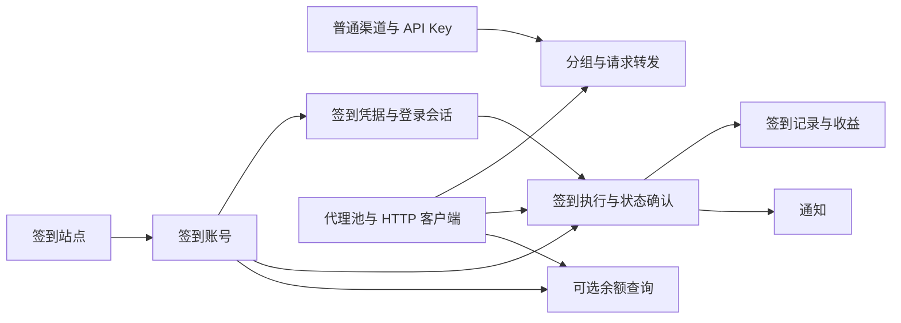

# v2 开发路线：普通渠道与独立签到

开发分支：`v2`。起点：`2158e12`（`feat(proxy): add SOCKS5H support`）。

本文件记录设计约定、实施依赖、验收标准和实际进度。完成项必须附实现位置或验证结果；部分完成不能勾选整个阶段。迁移预检通过只表示已完成报告覆盖的检查，不代表可以跳过备份、实际迁移及迁移后验收。

## 进度

| 阶段 | 状态 | 完成条件 |
| --- | --- | --- |
| P0 分支与路线 | 已完成 | 创建 v2，保存设计、阶段和验收标准 |
| P1 行为基线与迁移预检 | 已完成 | 已实现离线 JSON/ZIP 配置预检、转换清单、异常分类和样本回归 |
| P2 新签到数据与会话 | 已完成 | 独立 CRUD、凭据与代理保护、会话登录/刷新编排完成；MySQL/PostgreSQL 实际并发验证通过 |
| P3 独立签到执行 | 进行中 | 自定义 HTTP 提交、状态确认与历史持久化已实现；内置平台、调度/批次、余额收益和通知待完成 |
| P4 新 API 与前端 | 未开始 | 用户可通过独立签到页面管理全部配置，渠道统一展示 |
| P5 数据迁移与备份 | 未开始 | 渠道转换、新旧备份、重入及三种数据库迁移验证 |
| P6 删除旧模块与发布验收 | 未开始 | 移除订阅/投影运行时、更新文档、完成完整回归 |

开发按阶段推进。正式切换前必须同时完成迁移、接口和运行时适配，不在新旧服务之间双写。P1 的离线工具不执行数据库迁移。

## 目标与业务边界

保留普通渠道、分组、请求转发、模型同步、日志和渠道统计。现有投影渠道原位转换为普通渠道，不重新创建渠道或 Key。

签到站点、账号、凭据、会话、调度、状态确认、余额查询、收益和通知归签到模块管理。渠道与签到之间不建立业务绑定，共用代理池、HTTP 客户端、数据库和通知基础设施。



最终除旧数据转换代码外，业务不再引用订阅账号关联、`SiteChannelBinding`、`SiteToken`、`SiteUserGroup`、`SiteModel`。新建数据库不创建订阅业务表。

## 新数据模型

| 模型 | 主要职责与数据 |
| --- | --- |
| CheckinSite | 名称、平台、签到地址、启用/归档、代理默认值、公共 Header、时区/时间窗口、内置或 HTTP 执行方式、状态规则、奖励提取规则 |
| CheckinAccount | site_id、名称、credential_id、代理覆盖、自动签到/随机时间、下一次执行、最近结果、余额配置、待确认工作流 |
| CheckinCredential | 凭据类型、认证平台/地址、用户名/密码、Access Token、Refresh Token、Cookie、用户 ID、有效期、版本和刷新租约 |
| CheckinLog | 执行 ID、站点/账号 ID、名称快照、状态/原因、奖励、批次和时间 |
| CheckinBatchJob | 选中范围、进度、成功/失败/待确认数量及执行时间 |

新增 `checkin_sites`、`checkin_accounts`、`checkin_credentials`。现有签到日志和批次表可通过新模型的 TableName 映射复用，减少历史数据搬迁。有效签到站点/账号尽量保留原 ID；新记录自增序列必须与保留 ID 对齐。

新签到模型移除 `SiteKind`、`LinkedSiteID`、`LinkedAccountID`、`CheckinUseSubscriptionToken` 及订阅同步字段、模型/Key/分组/渠道关联。`CheckinSourceAccountID` 的来源追踪由迁移映射记录承担。

账号与凭据分离：通常一账号一凭据；共享同一登录会话时显式引用同一凭据。共享凭据没有渠道引用，不按用户名或 Token 内容自动去重。删除凭据前检查主签到和余额引用；删除账号不删除其他账号仍在使用的凭据。历史日志通过快照保留可读性，不级联删除。

归档只修改站点归档状态并清空待重算的调度时间，保留站点/账号启用设置、凭据和待确认任务；恢复不会重新启用原本停用的站点。归档站点拒绝新增账号。有账号的站点不能直接删除，账号存在未完成的已提交任务时也不能删除，应先归档/停用并完成状态确认。账号与站点删除不级联处理凭据、渠道或日志。

## 凭据版本与会话

`credential_version` 用于所有人工编辑和自动刷新写入的乐观锁；`identity_revision` 用于人工更换身份、类型或认证配置后的工作流失效判断。自动刷新不递增身份修订号，不中断正常待确认任务。

更新凭据必须携带预期版本，冲突返回 409。列表返回类型、配置状态、有效期、版本和引用数量；秘密字段只在修改时提交，省略表示保留。账号与新建内嵌凭据在同一事务中保存。

编辑补丁在事务锁内与当前记录合并。`false`、`0`、空字符串均是明确赋值；`proxy_config_id`、外部签到地址、状态规则、平台用户 ID 可用 `null` 清空，数组可用 `[]` 或 `null` 清空。`balance_config` 整体替换，`null` 表示禁用并解除自定义余额引用。凭据的 `expected_version` 必填；秘密字符串不能传 `null`，清除可选秘密需显式提交空字符串，必需秘密仍受模型校验约束。补丁拒绝归档状态、执行结果、提交标记、刷新租约等服务器字段。

站点执行配置变更会清除旧能力验证并重算调度，账号执行/调度配置变更也清除原调度时间。两者均不改写原工作流指纹或已提交标记；恢复与是否允许再次提交由 P3 执行层判断。站点锁串行化账号配置变更；共享凭据和代理按 ID 排序加锁，内嵌凭据创建失败完整回滚。

迁移现有 Sub2API 并发合并、数据库刷新租约、Token 成对保存、取消后限时完成保存及保存失败恢复逻辑。不能在多份记录上轮转同一个 Refresh Token。人工编辑与刷新冲突时，保留现有判断会话是否已更换的语义，设置编辑不能丢弃已签发的新令牌。

会话管理器 `internal/checkin.Sessions` 每个服务实例长期复用，按 `credential_id` 合并请求；数据库租约协调不同实例。`Ensure` 获取当前会话，`RecoverRead` 接受被拒绝的会话快照，为一次状态/余额重查获取新会话，不负责重发业务请求。密码凭据的用户名/密码变更会清除旧登录产生的 Token、Cookie 和用户 ID；自动登录与刷新只增加写入版本，不增加身份修订号。

在发送登录/刷新请求前持久化 `token_refresh_started`，不把租约过期当作可以重用 Refresh Token 的证据。请求超时、响应损坏、HTTP 5xx 等结果不明确时，保留标记并要求恢复已收到的结果或更换凭据；明确未消费的失败（发送前代理失败、HTTP 429）写入跨实例退避时间。认证交换单次上限 30 秒，保存总上限 5 秒、最多 3 次并指数退避；调用方取消不撤销共享交换或已签发凭据的保存。保存失败时在当前进程保留新 Token 对，后续仅重试保存；进程退出后没有新 Token 对可恢复，数据库标记阻止重复兑换，需人工获取新的登录凭据。

凭据摘要返回 `session_state: idle | exchanging | cooldown | needs_credentials`，不返回刷新所有者和秘密。会话备份以 `session_needs_repair` 保留结果不明确状态，不导出或恢复租约、锁及退避时间，避免导入后重用可能已消费的 Refresh Token。

AgentRouter 登录本身触发签到，不能在普通凭据测试或余额查询中自动登录。各平台的能力差异由适配器约束，不能把 API Key 一概作为平台签到凭据。

已实现 NewAPI/OneAPI/OneHub/DoneHub 的用户名密码登录、AnyRouter 的 Token/Cookie 登录、Sub2API 的 Access/Refresh Token 轮转，以及已有 Cookie/API Key 的读取。认证使用凭据自己的地址、代理和 Header；认证请求不携带过期 Bearer，不跟随重定向，不自动重发 POST。AnyRouter Cookie 使用独立 cookie jar 校验域、路径、过期状态；挑战处理、后续业务请求中的 Cookie 更新和用户 ID 探测在 P3 提取平台执行适配时接入。AgentRouter 已有会话可供读取；通用会话服务与存储层均拒绝隐式登录，显式登录签到留给 P3 的提交工作流。

## 地址、代理与认证

| 用途 | 地址 | 代理与 Header |
| --- | --- | --- |
| 签到提交和状态查询 | CheckinSite | 账号覆盖站点默认配置 |
| 登录和 Token 刷新 | CheckinCredential 认证地址 | 明确的认证代理、User-Agent、认证 Header |
| 余额查询 | 账号余额配置 | 独立配置或主凭据模式的继承值 |

普通平台默认认证地址为签到地址；外部 HTTP 签到可独立配置。HTTP 身份模式明确为 Cookie 或 Bearer，身份 Header 由凭据管理器注入，自动刷新由平台能力决定。保留原有重定向限制。

原 Sub2API 订阅令牌模式的签到/状态查询实际使用源账号代理及源站 User-Agent，迁移时将生效值写入新配置。同一旧登录会话存在不兼容认证网络配置时报告冲突，不悄悄复制或统一令牌。

代理池删除和引用计数要覆盖新签到站点、账号、认证及余额配置；禁用或缺失的池节点不能静默回退直连。

引用按配置用途计数：站点默认代理、账号覆盖、凭据认证、账号自定义余额各计一次；账号继承站点或余额继承凭据不重复计数。归档/停用不会解除引用。过渡期共享代理服务在新表存在时合并这些引用，新表尚未创建时可继续使用；元数据查询失败会返回错误，不能当作无引用处理。正式切换在 P6 移除旧实体查询。

## 余额与收益

账号可选 `BalanceConfig`，初期作为结构化配置字段保存，包含 `mode`、`platform`、`base_url`、`credential_id`、代理和 Header。

| mode | 行为 |
| --- | --- |
| disabled | 仅从签到/状态响应提取奖励 |
| primary | 使用主凭据及其平台服务地址查询余额 |
| custom | 独立配置余额地址、平台、凭据和网络 |

外部 Cookie 签到和到账平台凭据均由签到模块管理，不需要订阅站。奖励优先级：自定义提取结果、默认响应奖励、本次签到前后余额差。保留有效 0；失败/重复签到不重复记收益；余额失败不改变成功结果；恢复确认不使用过期余额快照补算。保持现有单位和收益统计语义。

## 执行与工作流约束

1. 加载最新站点、账号和凭据，检查启用、归档和配置完整性。
2. 优先恢复已有工作流，已提交任务只查询状态。
3. 获取会话，按平台规则提前刷新或恢复鉴权。
4. 执行配置要求的前置状态查询和可选余额快照。
5. 所有签到提交均先持久化提交标记，收到数据库提交确认后才发送一次签到。
6. 保存结果、调度时间，成功后刷新余额、补齐奖励并通知。

查询可按原规则恢复鉴权并重查；提交不能因超时或 401 自动重发。账号互斥和数据库工作流 CAS 分别保留。同一次工作流复用日志 ID；已提交标记在重启、迁移及恢复后均保留。手动/批量/定时入口重新检查停用和归档状态。

指纹使用执行配置、时区、credential_id、identity_revision 及实际请求网络配置，不包含自动轮转的 Access Token。迁移前先检查旧指纹有效性，再验证转换前后语义一致并重算新指纹；旧无效任务不能自动重新变成有效任务。

P3 当前实现 `internal/checkin.Engine` 的自定义 HTTP 工作流：`Execute` 创建或恢复执行，`Confirm` 只查询已有的已提交任务。账号的 `checkin_workflow_version` 与工作流日志 ID 共同控制状态转换；提交预占成功前不会发送 HTTP，数据库提交确认丢失时保留预占并禁止发送。提交请求关闭重定向、请求体重放和连接复用；401 只允许在后续状态查询中恢复会话一次，不重发签到。

前置状态为已签到时直接记录成功且不记奖励；未知状态不提交。已提交任务在取消、重启、日志缺失后仍只确认状态，缺失日志按原 ID 重建。确认失败或过期后仍可显式 `Confirm`；同日已经结束的提交由 `Execute` 返回原结果。只有未提交且未成功的失败、过期或配置失效任务允许手动重新开始。提交前再次检查日期、期限、配置指纹、停用/归档和定时时间窗口，自动入口还要求账号开启自动签到。

跨日确认要求日期字段或显式 JavaScript 判定；仅返回“今日状态”的接口在请求前后都检查日期，避免午夜响应确认错误日期。状态和奖励脚本共用 `internal/checkin/rules` 的受限运行时，旧路径通过薄封装复用。奖励与日志、账号最近结果在同一事务保存，竞争确认只允许一次写入，保留有效 0；恢复确认仅使用明确选择的状态响应奖励，不补算丢失的提交响应或旧余额差。`TodayIncome` 聚合、余额与通知仍待后续子项实现。

## 后端边界

| 位置 | 职责 |
| --- | --- |
| internal/model/checkin_*.go | 数据结构、纯校验、DTO |
| internal/op/checkin_*.go | CRUD、版本/租约、工作流提交、日志和统计 |
| internal/checkin | 执行、批次、调度、状态、收益、通知和平台适配 |
| internal/server/handlers/checkin_*.go | 管理员 API、参数和响应 |
| internal/task/checkin.go | 调度入口 |
| internal/migration/v2 | 旧数据预检、映射和转换；允许访问旧 DTO |

业务服务可以依赖新数据访问函数和基础设施，数据层不能反向依赖签到编排。保留使用到的登录、Cookie 会话、验证码、余额等能力，从 `internal/sitesync` 提取后再删除订阅专属代码。`projected_channel_auto_group.go` 中的普通渠道通用函数先移动，再删除投影分支。

## API 与界面

接口前缀为 `/api/v1/checkin`：

| 路径 | 操作 |
| --- | --- |
| /sites，/sites/:id | GET/POST、GET/PATCH/DELETE |
| /sites/:id/archive，/restore | POST |
| /accounts，/accounts/:id | GET/POST、PATCH/DELETE |
| /credentials，/credentials/:id | 摘要 GET/POST、PATCH/DELETE |
| /accounts/:id/execute，/confirm | POST；后者只确认已提交任务 |
| /batches，/batches/:id | POST/GET、GET |
| /logs，/stats，/capabilities | GET |
| /reward/test，/status/test | POST，仅本地样例测试 |

创建账号的 `credential` 与 `credential_id` 二选一。批次显式使用 `scope: all | selected`；selected 必须是非空有效范围，不得回退到全量。重复同范围活动批次复用，冲突范围返回 409。

前端移除订阅站导航和投影页签。签到页面管理全部站点、凭据、余额配置、记录和收益。渠道统一编辑；分组按渠道/协议展示；日志移除订阅模型禁用操作；代理引用更新到新实体。移除订阅同步和投影全局设置，保留普通模型同步和签到调度。

正式切换删除订阅和 `/api/v1/site-channel` 接口。旧数据兼容集中在转换代码，不增加永久旧接口转发或旧表回读。

## 投影渠道转换

保留渠道/Key ID、地址、协议、模型、Key、Header、参数覆盖、代理及当前启用状态，保留 GroupItem、权重、优先级和普通渠道统计。清除托管标记和绑定。

将投影全局自动分组覆盖值写入各原投影渠道的 AutoGroup；解除投影不会自动开启模型同步。已经按协议拆分的渠道分别保留，不重新合并。不从旧订阅缓存生成不存在的渠道。

旧 StatsSiteModelHourly 按账号/分组/模型统计，不合并进普通渠道累计值，避免重复计算；作为迁移归档保留。移除转发中的站点模型路由学习和后台重新投影。

现有删除/归档站点服务会删除投影渠道，迁移不能调用这些业务删除接口。

## 数据库升级

顺序：预检、备份、停止旧写入、建新表与迁移记录、签到/凭据迁移、余额迁移、渠道转换、工作流校验、运行时切换。

迁移版本和阶段状态必须持久化；记录来源 ID 映射。重复执行不重复创建凭据或覆盖已完成数据。MySQL DDL 与 DML 分阶段处理，不假设建表可以随数据事务一起回滚。覆盖 SQLite、MySQL 和 PostgreSQL。

缺失关联凭据时保留账号和历史并暂停自动执行，提示补充配置；不使用残留旧秘密作为自动回退。已提交任务缺少凭据时保留提交标记。余额失效不阻断独立 Cookie 签到。异常渠道引用进入报告，不自动删改。

首次切换可暂存旧表归档，后续独立清理。新运行时不再读写旧表。回退使用迁移前备份；不能将保留旧表误认为支持旧二进制直接运行。

## 备份

新备份 version 2 使用新签到与普通渠道模型。version 1 走独立旧 DTO 转换器，再统一验证和事务导入。同一备份内的共享源会话映射到同一新凭据。

重复导入不覆盖已人工修改的凭据；统一映射账号、凭据、代理、日志和批次范围。不恢复刷新租约和运行锁；活动批次标记中断。缺少日志但有待确认工作流时重建确认记录并保留已提交状态。不能确认来源的冲突显式报告。

替换启动/备份导入中旧的 SeparateLegacySiteCheckins 调用链，避免重建订阅关联。第三方订阅导入随订阅模块退出；已有数据通过数据库/备份迁移承接。

## 阶段任务与验收

- [x] P0：创建 v2 并写入本路线。
- [x] P1：可执行离线备份预检；统计渠道、签到、共享凭据、余额、代理、待确认任务；报告异常及缺失数据；样本回归通过。
- [x] P2：独立签到模型及事务 CRUD；凭据引用/删除、两个版本、共享刷新、Token 保存冲突处理通过测试，MySQL/PostgreSQL 实际并发验证通过。
- [ ] P3：提取平台适配及执行，覆盖 AgentRouter 登录副作用、Cookie/Bearer、待确认恢复、收益/通知和调度。
- [ ] P4：新 API 与界面完成；签到配置不要求订阅站；渠道、分组、日志、代理引用统一。
- [ ] P5：渠道转换、旧库重入/断点迁移、新备份往返、旧备份重复导入、三种数据库验证完成。
- [ ] P6：删除旧业务；新库不创建订阅表，移除旧表仍能转发/签到；文档、Go/前端/端到端回归通过。

必须验证：渠道与分组 ID/配置不丢失；停用渠道不被启用；共享 Refresh Token 只轮转一次；人工更新不被旧刷新覆盖；跨地址签到的认证/代理正确；迁移/重启/401/超时不重复提交；奖励只记一次；原无效指纹不会被迁移重新授权；异常引用有明确处理结果。

## 当前可用的开发入口

离线预检命令：

```powershell
go run . migrate v2-preflight --input D:\Backups\octopus-backup.zip > v2-preflight.json
```

也接受版本 1 的 JSON 备份。命令不连接数据库、不启动任务、不修改备份。stdout 输出 JSON 报告；有 blocker 时仍输出报告并返回非零退出码，错误说明写入 stderr。review 表示转换时必须处理或核对的情形。零 blocker 只代表当前配置预检没有发现阻断项，不代表迁移已执行或已完成上线验收。

报告包括：订阅/签到站点数量、普通/投影渠道、渠道 ID/Key ID/分组 ID、有效自动分组值、代理引用、签到和余额的凭据来源、共享来源、待确认任务提交状态和旧指纹有效性。不输出名称、URL、密码、Token、Cookie、原始请求体或 Header。

预检只检查配置。ZIP 历史/请求正文不解压，JSON 历史流式跳过；ZIP 配置解压总量和 JSON 文件大小上限为 128 MiB，大历史使用 ZIP。历史日志完整性、实际连接可用性、数据库结构及完整迁移验收属于 P5。

| 代表性 issue code | 含义与后续处理 |
| --- | --- |
| checkin_credentials_unavailable | 关联缺失或凭据不兼容；迁移时保留账号并要求补充，不使用残留凭据 |
| balance_credentials_unavailable | 可选余额配置不可用；不阻止独立 Cookie 签到 |
| shared_credential_network_conflict | 同一源凭据被不同网络配置使用；切换前确定认证配置归属 |
| workflow_fingerprint_changed | 原工作流已失效，不能仅重算指纹后重新激活 |
| submitted_workflow_must_not_resubmit | 保留提交标记，迁移后只确认状态 |
| legacy_checkin_requires_split | 备份仍含旧订阅站上的签到，需要旧格式转换阶段先分离 |
| proxy_unavailable / proxy_reference_missing | 不允许静默回退直连，需保留不可用状态或修复引用 |
| invalid_binding_source / binding_channel_missing | 渠道绑定不完整，不能通过业务删除接口清理 |

P2 的 `PrepareCheckinSchema`、`CheckinStore` 和 `internal/checkin.Sessions` 是显式调用的开发基础，尚未接入应用启动、公开 API 或备份。开发测试使用独立 SQLite 数据库，不创建订阅表；共享代理兼容测试另用现有测试初始化入口验证新旧引用共存。线上运行时仍使用现有路径；新模型的切换依赖 P3–P5。`CheckinCredentialInput` 仅用于明确提交秘密；普通响应使用 `CheckinCredentialSummary`，备份 DTO `CheckinCredentialBackup` 显式导出秘密且不携带刷新租约，完整 v2 备份导入/导出仍属于 P5。

P3 增加 `NewEngine(store, sessions, proxies)`、`Execute(ctx, accountID, trigger)` 和 `Confirm(ctx, accountID)` 开发入口，使用注入的独立存储与长期复用的会话服务。目前只支持自定义 HTTP Cookie/Bearer 签到，内置平台返回适配器尚不可用；trigger 用于入口约束与记录来源，不代表已经接入调度或批次服务。`CheckinLog` 映射已有 `site_checkin_logs`，旧模型暂以别名复用以保持生产路径兼容；显式 schema 准备可幂等补充工作流版本列，保留提交标记和历史。不启动新运行时，也不与旧路径双写。

数据库集成测试入口：设置 `CHECKIN_TEST_MYSQL_DSN` 或 `CHECKIN_TEST_POSTGRES_DSN` 后运行 `go test -race ./internal/op -run '^TestIndependentCheckinDatabases$' -count=1 -v`。DSN 应指向可创建数据库的专用测试服务器；每次创建随机名称的测试数据库并仅删除该数据库，不改动已有业务库。未设置 DSN 时明确跳过对应测试。`.github/workflows/checkin-databases.yml` 为 v2 提供 MySQL 8.4 / PostgreSQL 17 服务，覆盖多连接租约竞争、已发送租约过期、设置编辑与刷新保存、旧版本冲突、凭据创建引用与删除竞争；P3 新增工作流提交预占与确认的 CAS 竞争。独立存储在 MySQL/PostgreSQL 上显式使用 READ COMMITTED，避免引用检查读取到加锁前的旧快照。

远端验证：提交 `4621ea4` 的 [数据库集成 CI](https://github.com/suprelory/octopus-plus/actions/runs/43907612346) 已通过，MySQL 8.4 与 PostgreSQL 17 子测试均实际执行并 PASS；[完整 CI](https://github.com/suprelory/octopus-plus/actions/runs/43907612265) 的后端与前端均通过。上述结果覆盖 P2；本轮新增的 P3 工作流数据库用例尚未提交到远端执行，不能沿用 P2 结果宣称其已通过。

P2 已完成的子项：

- [x] 独立站点/账号/凭据模型和认证/余额/代理校验。
- [x] 创建站点、账号、内嵌凭据的事务；保留显式 false；失败回滚凭据。
- [x] 共享凭据及余额引用检查、凭据编辑版本冲突和删除保护。
- [x] 数据库刷新租约、Token 成对保存、人工修改保护和保存确认重试。
- [x] 自动 Token 轮转与人工身份修订分离；工作流指纹验证。
- [x] 站点/账号补丁编辑、列表、归档/恢复及删除保护；保留提交标记与历史执行字段；新代理引用的计数、报告与删除保护。
- [x] API 用的字段补丁与凭据状态摘要、备份用的明确秘密导出 DTO；省略/清空/零值与秘密导出边界回归通过。
- [x] 独立平台会话编排、并发请求合并、有限超时保存重试及失败退避；已收到结果仅重试保存、未知结果禁止重新兑换；不依赖订阅实体。
- [x] 登录平台差异、AgentRouter 隐式登录保护、认证地址/代理/Header 与 Cookie 隔离回归；新增会话字段的幂等建表升级和备份待修复标记。
- [x] MySQL/PostgreSQL 的并发租约与引用锁实际验证（`4621ea4` 的数据库集成 CI 已实际执行并通过）。

P3 已完成的子项与剩余顺序：

- [x] 自定义 HTTP Cookie/Bearer 提交和状态查询；凭据权威注入、认证与业务地址/代理分离、模板转义、响应限制和敏感内容隔离。
- [x] 账号互斥、数据库工作流版本 CAS、提交预占、重启/取消/缺失日志恢复、同日结果重放和显式确认。
- [x] 抽取共享状态判定、已签到消息识别和受限 JavaScript 奖励规则；保留原有空响应脚本与奖励字符串规范化语义。
- [x] 日志复用、账号最近结果与奖励的原子持久化；配置失效、跨日确认、并发提交/确认及提交确认丢失的 SQLite/HTTP 回归。
- [ ] MySQL/PostgreSQL 上实际运行新增的工作流提交预占与确认竞争用例（已接入现有数据库 CI）。
- [ ] 提取内置平台执行适配；处理 AgentRouter 显式登录即签到、AnyRouter 挑战、Cookie 更新及用户 ID 探测。
- [ ] 接入独立调度与批次：随机时间、下一次执行/失败退避、待确认调度、范围校验、并发控制与进度统计。
- [ ] 接入独立余额查询、签到前后余额差、收益聚合和通知去重；余额失败不改变签到成功结果。
- [ ] 完成 P3 服务验收后进入 P4 API/前端；生产切换仍等待 P3–P5 全部完成。

## 开发记录

- 2026-11-15：从 dev 的 2158e12 创建 v2；保存设计方案。开始 P1 的离线迁移预检与回归样本。
- 2026-11-15：完成 P1 离线预检及命令入口。进入 P2，增加独立模型和显式存储基础；新表未接入生产初始化，完整切换仍待 P3–P5。
- 2026-11-15：验证通过 `go test ./...`；独立签到模型、迁移预检和存储并发用例通过 `go test -race ./internal/model ./internal/migration/v2 ./internal/op -run 'TestIndependentCheckin|TestCheckinWorkflowIdentity|TestCheckinCredentialJSON|TestCheckinValidation|TestPreflight'`。已验证 CLI 帮助及命令测试。数据库行为测试目前为 SQLite；MySQL/PostgreSQL 运行验证待后续阶段。
- 2026-11-16：上一阶段以 `ebff5c9`（`feat(v2): add migration preflight and independent check-in foundations`）提交并推送至 `origin/v2`。
- 2026-11-16：继续 P2；实现 `internal/model/checkin_requests.go`、`checkin_credential_dto.go`、`internal/op/checkin_lifecycle.go` 与 `checkin_proxy.go`。覆盖待确认任务保留、归档恢复、无级联删除、引用变更回滚、凭据补丁/刷新冲突，以及认证/余额/站点/账号代理保护。
- 2026-11-16：本轮验证通过 `go test ./...`、`go test -race ./internal/model ./internal/op -run 'TestIndependentCheckin|TestCheckin|TestProxyConfiguration'` 和 `git diff --check`。并发用例仍基于 SQLite，不能替代 MySQL/PostgreSQL 的行锁与隔离级别验证。P2 保持进行中，后续接入平台会话编排、有限超时保存重试及失败退避。
- 2026-11-17：继续 P2，在 `internal/checkin` 增加独立会话服务与 HTTP 认证适配，接入 `CheckinStore` 登录/刷新事务、持久化发送标记及退避；保存不受原请求取消影响，保留人工配置及身份修改。增加认证代理的实时可用性查询，已有 P2 schema 可幂等增加会话字段。
- 2026-11-17：加入 MySQL/PostgreSQL 多连接集成测试及独立 CI workflow，主 CI 的 v2 分支与新包竞态检测已启用。当前本地无数据库服务或测试 DSN，两种数据库用例明确 SKIP，P2 不标记整体完成。后续先取得数据库集成结果，再进入 P3 的提交/确认工作流、平台挑战与会话更新、调度及余额收益。
- 2026-11-17：本轮验证通过 `go test ./...`、`go test -race ./internal/checkin ./internal/db ./internal/model ./internal/op -run 'TestSessions|TestSessionJWT|TestHTTPAuth|TestIndependentCheckin|TestCheckin|TestPrepareCheckinSchema'`、`go vet ./internal/checkin ./internal/op ./internal/model ./internal/db` 和 `git diff --check`。最终 HTTP 请求重放/响应校验补充后，完整 Go 测试、新会话包竞态检测及上述 vet 再次通过。尚未执行远端 CI，尚未接入新生产运行路径。
- 2026-11-17：P2 会话管理以 `4621ea4`（`feat(v2): add independent check-in session management`）提交并推送至 `origin/v2`。远端完整 CI 与 MySQL/PostgreSQL 集成 CI 均通过，P2 标记完成。
- 2026-11-17：进入 P3，新增 `internal/checkin/engine.go`、`http_checkin.go`、`internal/op/checkin_workflow.go` 与独立历史模型；共享规则迁入 `internal/checkin/rules`。实现自定义 HTTP 提交/确认闭环，覆盖取消、重启、缺失日志、401、配置变更、提交确认丢失和跨午夜响应。P3 保持进行中，内置平台、调度/批次、余额收益与通知尚未接入。
- 2026-11-17：P3 本轮最终验证通过 `go test ./...`、`go test -race ./internal/checkin/... ./internal/db ./internal/model ./internal/op ./internal/sitesync -run 'TestWorkflow|TestSessions|TestSessionJWT|TestHTTPAuth|TestIndependentCheckin|TestCheckin|TestStatusCheckin|TestPrepareCheckinSchema|TestExtractCheckinReward' -count=1 -timeout 180s`、`go vet ./internal/checkin/... ./internal/op ./internal/model ./internal/db ./internal/sitesync`、gofmt 检查与 `git diff --check`。补充旧开发库 schema 幂等升级、历史表复用、空响应脚本和空格奖励的兼容回归。本地未配置 MySQL/PostgreSQL DSN，新增 P3 数据库用例明确跳过，待本轮提交后的远端 CI 执行。
