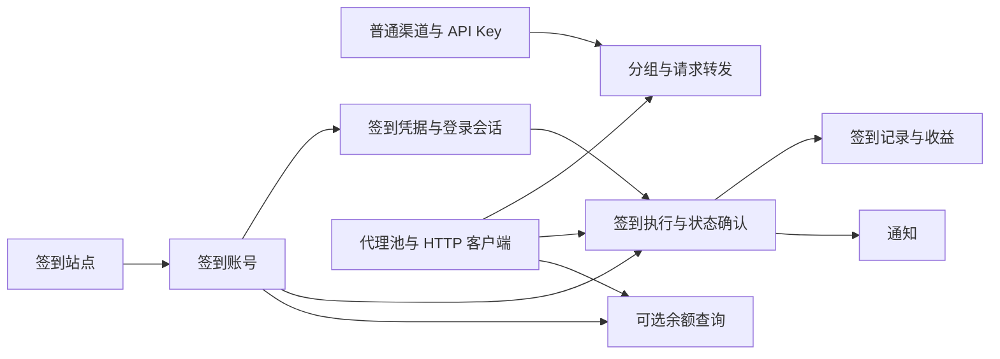

# v2 开发路线：普通渠道与独立签到

开发分支：`v2`。起点：`2158e12`（`feat(proxy): add SOCKS5H support`）。

本文件记录设计约定、实施依赖、验收标准和实际进度。完成项必须附实现位置或验证结果；部分完成不能勾选整个阶段。迁移预检通过只表示已完成报告覆盖的检查，不代表可以跳过备份、实际迁移及迁移后验收。

## 进度

| 阶段 | 状态 | 完成条件 |
| --- | --- | --- |
| P0 分支与路线 | 已完成 | 创建 v2，保存设计、阶段和验收标准 |
| P1 行为基线与迁移预检 | 已完成 | 已实现离线 JSON/ZIP 配置预检、转换清单、异常分类和样本回归 |
| P2 新签到数据与会话 | 进行中 | 模型、建表、创建/读取、凭据编辑/引用及刷新事务已实现；完整账号/站点编辑与运行时会话编排待完成 |
| P3 独立签到执行 | 未开始 | 签到、状态、调度、余额和通知不再依赖订阅实体 |
| P4 新 API 与前端 | 未开始 | 用户可通过独立签到页面管理全部配置，渠道统一展示 |
| P5 数据迁移与备份 | 未开始 | 渠道转换、新旧备份、重入及三种数据库迁移验证 |
| P6 删除旧模块与发布验收 | 未开始 | 移除订阅/投影运行时、更新文档、完成完整回归 |

开发按阶段推进。正式切换前必须同时完成迁移、接口和运行时适配，不在新旧服务之间双写。P1 的离线工具不执行数据库迁移。

## 目标与业务边界

保留普通渠道、分组、请求转发、模型同步、日志和渠道统计。现有投影渠道原位转换为普通渠道，不重新创建渠道或 Key。

签到站点、账号、凭据、会话、调度、状态确认、余额查询、收益和通知归签到模块管理。渠道与签到之间不建立业务绑定，共用代理池、HTTP 客户端、数据库和通知基础设施。



最终除旧数据转换代码外，业务不再引用订阅账号关联、`SiteChannelBinding`、`SiteToken`、`SiteUserGroup`、`SiteModel`。新建数据库不创建订阅业务表。

## 新数据模型

| 模型 | 主要职责与数据 |
| --- | --- |
| CheckinSite | 名称、平台、签到地址、启用/归档、代理默认值、公共 Header、时区/时间窗口、内置或 HTTP 执行方式、状态规则、奖励提取规则 |
| CheckinAccount | site_id、名称、credential_id、代理覆盖、自动签到/随机时间、下一次执行、最近结果、余额配置、待确认工作流 |
| CheckinCredential | 凭据类型、认证平台/地址、用户名/密码、Access Token、Refresh Token、Cookie、用户 ID、有效期、版本和刷新租约 |
| CheckinLog | 执行 ID、站点/账号 ID、名称快照、状态/原因、奖励、批次和时间 |
| CheckinBatchJob | 选中范围、进度、成功/失败/待确认数量及执行时间 |

新增 `checkin_sites`、`checkin_accounts`、`checkin_credentials`。现有签到日志和批次表可通过新模型的 TableName 映射复用，减少历史数据搬迁。有效签到站点/账号尽量保留原 ID；新记录自增序列必须与保留 ID 对齐。

新签到模型移除 `SiteKind`、`LinkedSiteID`、`LinkedAccountID`、`CheckinUseSubscriptionToken` 及订阅同步字段、模型/Key/分组/渠道关联。`CheckinSourceAccountID` 的来源追踪由迁移映射记录承担。

账号与凭据分离：通常一账号一凭据；共享同一登录会话时显式引用同一凭据。共享凭据没有渠道引用，不按用户名或 Token 内容自动去重。删除凭据前检查主签到和余额引用；删除账号不删除其他账号仍在使用的凭据。历史日志通过快照保留可读性，不级联删除。

## 凭据版本与会话

`credential_version` 用于所有人工编辑和自动刷新写入的乐观锁；`identity_revision` 用于人工更换身份、类型或认证配置后的工作流失效判断。自动刷新不递增身份修订号，不中断正常待确认任务。

更新凭据必须携带预期版本，冲突返回 409。列表返回类型、配置状态、有效期、版本和引用数量；秘密字段只在修改时提交，省略表示保留。账号与新建内嵌凭据在同一事务中保存。

迁移现有 Sub2API 并发合并、数据库刷新租约、Token 成对保存、取消后限时完成保存及保存失败恢复逻辑。不能在多份记录上轮转同一个 Refresh Token。人工编辑与刷新冲突时，保留现有判断会话是否已更换的语义，设置编辑不能丢弃已签发的新令牌。

AgentRouter 登录本身触发签到，不能在普通凭据测试或余额查询中自动登录。各平台的能力差异由适配器约束，不能把 API Key 一概作为平台签到凭据。

## 地址、代理与认证

| 用途 | 地址 | 代理与 Header |
| --- | --- | --- |
| 签到提交和状态查询 | CheckinSite | 账号覆盖站点默认配置 |
| 登录和 Token 刷新 | CheckinCredential 认证地址 | 明确的认证代理、User-Agent、认证 Header |
| 余额查询 | 账号余额配置 | 独立配置或主凭据模式的继承值 |

普通平台默认认证地址为签到地址；外部 HTTP 签到可独立配置。HTTP 身份模式明确为 Cookie 或 Bearer，身份 Header 由凭据管理器注入，自动刷新由平台能力决定。保留原有重定向限制。

原 Sub2API 订阅令牌模式的签到/状态查询实际使用源账号代理及源站 User-Agent，迁移时将生效值写入新配置。同一旧登录会话存在不兼容认证网络配置时报告冲突，不悄悄复制或统一令牌。

代理池删除和引用计数要覆盖新签到站点、账号、认证及余额配置；禁用或缺失的池节点不能静默回退直连。

## 余额与收益

账号可选 `BalanceConfig`，初期作为结构化配置字段保存，包含 `mode`、`platform`、`base_url`、`credential_id`、代理和 Header。

| mode | 行为 |
| --- | --- |
| disabled | 仅从签到/状态响应提取奖励 |
| primary | 使用主凭据及其平台服务地址查询余额 |
| custom | 独立配置余额地址、平台、凭据和网络 |

外部 Cookie 签到和到账平台凭据均由签到模块管理，不需要订阅站。奖励优先级：自定义提取结果、默认响应奖励、本次签到前后余额差。保留有效 0；失败/重复签到不重复记收益；余额失败不改变成功结果；恢复确认不使用过期余额快照补算。保持现有单位和收益统计语义。

## 执行与工作流约束

1. 加载最新站点、账号和凭据，检查启用、归档和配置完整性。
2. 优先恢复已有工作流，已提交任务只查询状态。
3. 获取会话，按平台规则提前刷新或恢复鉴权。
4. 执行配置要求的前置状态查询和可选余额快照。
5. 需要状态确认时，先持久化提交标记，再发送一次签到。
6. 保存结果、调度时间，成功后刷新余额、补齐奖励并通知。

查询可按原规则恢复鉴权并重查；提交不能因超时或 401 自动重发。账号互斥和数据库工作流 CAS 分别保留。同一次工作流复用日志 ID；已提交标记在重启、迁移及恢复后均保留。手动/批量/定时入口重新检查停用和归档状态。

指纹使用执行配置、时区、credential_id、identity_revision 及实际请求网络配置，不包含自动轮转的 Access Token。迁移前先检查旧指纹有效性，再验证转换前后语义一致并重算新指纹；旧无效任务不能自动重新变成有效任务。

## 后端边界

| 位置 | 职责 |
| --- | --- |
| internal/model/checkin_*.go | 数据结构、纯校验、DTO |
| internal/op/checkin_*.go | CRUD、版本/租约、工作流提交、日志和统计 |
| internal/checkin | 执行、批次、调度、状态、收益、通知和平台适配 |
| internal/server/handlers/checkin_*.go | 管理员 API、参数和响应 |
| internal/task/checkin.go | 调度入口 |
| internal/migration/v2 | 旧数据预检、映射和转换；允许访问旧 DTO |

业务服务可以依赖新数据访问函数和基础设施，数据层不能反向依赖签到编排。保留使用到的登录、Cookie 会话、验证码、余额等能力，从 `internal/sitesync` 提取后再删除订阅专属代码。`projected_channel_auto_group.go` 中的普通渠道通用函数先移动，再删除投影分支。

## API 与界面

接口前缀为 `/api/v1/checkin`：

| 路径 | 操作 |
| --- | --- |
| /sites，/sites/:id | GET/POST、GET/PATCH/DELETE |
| /sites/:id/archive，/restore | POST |
| /accounts，/accounts/:id | GET/POST、PATCH/DELETE |
| /credentials，/credentials/:id | 摘要 GET/POST、PATCH/DELETE |
| /accounts/:id/execute，/confirm | POST；后者只确认已提交任务 |
| /batches，/batches/:id | POST/GET、GET |
| /logs，/stats，/capabilities | GET |
| /reward/test，/status/test | POST，仅本地样例测试 |

创建账号的 `credential` 与 `credential_id` 二选一。批次显式使用 `scope: all | selected`；selected 必须是非空有效范围，不得回退到全量。重复同范围活动批次复用，冲突范围返回 409。

前端移除订阅站导航和投影页签。签到页面管理全部站点、凭据、余额配置、记录和收益。渠道统一编辑；分组按渠道/协议展示；日志移除订阅模型禁用操作；代理引用更新到新实体。移除订阅同步和投影全局设置，保留普通模型同步和签到调度。

正式切换删除订阅和 `/api/v1/site-channel` 接口。旧数据兼容集中在转换代码，不增加永久旧接口转发或旧表回读。

## 投影渠道转换

保留渠道/Key ID、地址、协议、模型、Key、Header、参数覆盖、代理及当前启用状态，保留 GroupItem、权重、优先级和普通渠道统计。清除托管标记和绑定。

将投影全局自动分组覆盖值写入各原投影渠道的 AutoGroup；解除投影不会自动开启模型同步。已经按协议拆分的渠道分别保留，不重新合并。不从旧订阅缓存生成不存在的渠道。

旧 StatsSiteModelHourly 按账号/分组/模型统计，不合并进普通渠道累计值，避免重复计算；作为迁移归档保留。移除转发中的站点模型路由学习和后台重新投影。

现有删除/归档站点服务会删除投影渠道，迁移不能调用这些业务删除接口。

## 数据库升级

顺序：预检、备份、停止旧写入、建新表与迁移记录、签到/凭据迁移、余额迁移、渠道转换、工作流校验、运行时切换。

迁移版本和阶段状态必须持久化；记录来源 ID 映射。重复执行不重复创建凭据或覆盖已完成数据。MySQL DDL 与 DML 分阶段处理，不假设建表可以随数据事务一起回滚。覆盖 SQLite、MySQL 和 PostgreSQL。

缺失关联凭据时保留账号和历史并暂停自动执行，提示补充配置；不使用残留旧秘密作为自动回退。已提交任务缺少凭据时保留提交标记。余额失效不阻断独立 Cookie 签到。异常渠道引用进入报告，不自动删改。

首次切换可暂存旧表归档，后续独立清理。新运行时不再读写旧表。回退使用迁移前备份；不能将保留旧表误认为支持旧二进制直接运行。

## 备份

新备份 version 2 使用新签到与普通渠道模型。version 1 走独立旧 DTO 转换器，再统一验证和事务导入。同一备份内的共享源会话映射到同一新凭据。

重复导入不覆盖已人工修改的凭据；统一映射账号、凭据、代理、日志和批次范围。不恢复刷新租约和运行锁；活动批次标记中断。缺少日志但有待确认工作流时重建确认记录并保留已提交状态。不能确认来源的冲突显式报告。

替换启动/备份导入中旧的 SeparateLegacySiteCheckins 调用链，避免重建订阅关联。第三方订阅导入随订阅模块退出；已有数据通过数据库/备份迁移承接。

## 阶段任务与验收

- [x] P0：创建 v2 并写入本路线。
- [x] P1：可执行离线备份预检；统计渠道、签到、共享凭据、余额、代理、待确认任务；报告异常及缺失数据；样本回归通过。
- [ ] P2：独立签到模型及事务 CRUD；凭据引用/删除、两个版本、共享刷新、Token 保存冲突处理通过测试。
- [ ] P3：提取平台适配及执行，覆盖 AgentRouter 登录副作用、Cookie/Bearer、待确认恢复、收益/通知和调度。
- [ ] P4：新 API 与界面完成；签到配置不要求订阅站；渠道、分组、日志、代理引用统一。
- [ ] P5：渠道转换、旧库重入/断点迁移、新备份往返、旧备份重复导入、三种数据库验证完成。
- [ ] P6：删除旧业务；新库不创建订阅表，移除旧表仍能转发/签到；文档、Go/前端/端到端回归通过。

必须验证：渠道与分组 ID/配置不丢失；停用渠道不被启用；共享 Refresh Token 只轮转一次；人工更新不被旧刷新覆盖；跨地址签到的认证/代理正确；迁移/重启/401/超时不重复提交；奖励只记一次；原无效指纹不会被迁移重新授权；异常引用有明确处理结果。

## 当前可用的开发入口

离线预检命令：

```powershell
go run . migrate v2-preflight --input D:\Backups\octopus-backup.zip > v2-preflight.json
```

也接受版本 1 的 JSON 备份。命令不连接数据库、不启动任务、不修改备份。stdout 输出 JSON 报告；有 blocker 时仍输出报告并返回非零退出码，错误说明写入 stderr。review 表示转换时必须处理或核对的情形。零 blocker 只代表当前配置预检没有发现阻断项，不代表迁移已执行或已完成上线验收。

报告包括：订阅/签到站点数量、普通/投影渠道、渠道 ID/Key ID/分组 ID、有效自动分组值、代理引用、签到和余额的凭据来源、共享来源、待确认任务提交状态和旧指纹有效性。不输出名称、URL、密码、Token、Cookie、原始请求体或 Header。

预检只检查配置。ZIP 历史/请求正文不解压，JSON 历史流式跳过；ZIP 配置解压总量和 JSON 文件大小上限为 128 MiB，大历史使用 ZIP。历史日志完整性、实际连接可用性、数据库结构及完整迁移验收属于 P5。

| 代表性 issue code | 含义与后续处理 |
| --- | --- |
| checkin_credentials_unavailable | 关联缺失或凭据不兼容；迁移时保留账号并要求补充，不使用残留凭据 |
| balance_credentials_unavailable | 可选余额配置不可用；不阻止独立 Cookie 签到 |
| shared_credential_network_conflict | 同一源凭据被不同网络配置使用；切换前确定认证配置归属 |
| workflow_fingerprint_changed | 原工作流已失效，不能仅重算指纹后重新激活 |
| submitted_workflow_must_not_resubmit | 保留提交标记，迁移后只确认状态 |
| legacy_checkin_requires_split | 备份仍含旧订阅站上的签到，需要旧格式转换阶段先分离 |
| proxy_unavailable / proxy_reference_missing | 不允许静默回退直连，需保留不可用状态或修复引用 |
| invalid_binding_source / binding_channel_missing | 渠道绑定不完整，不能通过业务删除接口清理 |

P2 的 `PrepareCheckinSchema` 和 `CheckinStore` 是显式调用的开发基础，尚未接入应用启动、公开 API 或备份。开发测试使用独立 SQLite 数据库，不创建订阅表。线上运行时仍使用现有路径；新模型的切换依赖 P3–P5。

P2 已完成的子项：

- [x] 独立站点/账号/凭据模型和认证/余额/代理校验。
- [x] 创建站点、账号、内嵌凭据的事务；保留显式 false；失败回滚凭据。
- [x] 共享凭据及余额引用检查、凭据编辑版本冲突和删除保护。
- [x] 数据库刷新租约、Token 成对保存、人工修改保护和保存确认重试。
- [x] 自动 Token 轮转与人工身份修订分离；工作流指纹验证。
- [ ] 站点/账号完整编辑、归档/删除生命周期和新代理引用管理。
- [ ] API 用的字段补丁与凭据状态摘要、备份用的明确秘密导出 DTO。
- [ ] 平台会话编排、并发请求合并、有限超时保存重试及失败退避接入。
- [ ] MySQL/PostgreSQL 的并发租约与引用锁验证。

## 开发记录

- 2026-11-15：从 dev 的 2158e12 创建 v2；保存设计方案。开始 P1 的离线迁移预检与回归样本。
- 2026-11-15：完成 P1 离线预检及命令入口。进入 P2，增加独立模型和显式存储基础；新表未接入生产初始化，完整切换仍待 P3–P5。
- 2026-11-15：验证通过 `go test ./...`；独立签到模型、迁移预检和存储并发用例通过 `go test -race ./internal/model ./internal/migration/v2 ./internal/op -run 'TestIndependentCheckin|TestCheckinWorkflowIdentity|TestCheckinCredentialJSON|TestCheckinValidation|TestPreflight'`。已验证 CLI 帮助及命令测试。数据库行为测试目前为 SQLite；MySQL/PostgreSQL 运行验证待后续阶段。
